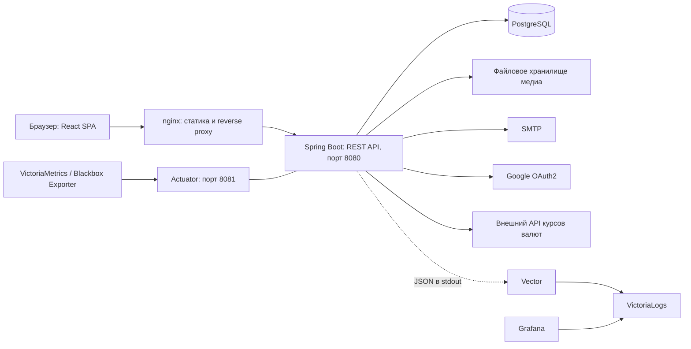

# StyleMap

StyleMap — социальная платформа для публикации аутфитов: фотографий и видео с описанием вещей, ценами и ссылками «где купить». Пользователи просматривают ленту, оценивают образы и подписываются на авторов. Проект объединяет React SPA, REST API на Spring Boot и PostgreSQL; отдельные Kubernetes-конфигурации показывают сбор логов, метрик и демонстрацию SLI/SLO.

## Возможности

- Создание поста с одним фото или видео, описанием, вещами, брендами и ссылками на магазины; редактирование описания, вещей и хештегов, удаление собственных публикаций.
- Лента с пагинацией, сортировкой по дате или рейтингу, фильтрацией по хештегам и подпискам; автодополнение хештегов.
- Оценки от 1 до 10 с обновлением своей оценки и пересчётом среднего рейтинга.
- Подписки на авторов, просмотр профиля, его публикаций и счётчиков подписчиков/подписок.
- Пересчёт цен между валютами через внешний API `cbr-xml-daily.ru`.
- Регистрация по имени пользователя и паролю, подтверждение email кодом, вход через Google OAuth2.
- Панель ADMIN: просмотр, создание и удаление пользователей, изменение активности аккаунта; управление постами и хештегами.

## Архитектура



Frontend обращается к API через `fetch` с сессионной cookie и CSRF-заголовком. nginx отдаёт сборку SPA, обрабатывает клиентские маршруты и проксирует `/api/`, `/auth/`, `/uploads/`, `/oauth2/`, `/login/oauth2/` на backend, сохраняя единый origin.

Backend содержит контроллеры, сервисы с транзакциями и Spring Data репозитории. PostgreSQL хранит пользователей, посты и связанные данные; файлы медиа находятся отдельно на диске. Помимо SPA в backend сохранены Thymeleaf-страницы аутентификации, showroom и администрирования.

Компоненты наблюдаемости на диаграмме относятся к Kubernetes-окружению и не входят в Docker Compose.

## Технологический стек

| Область | Технологии |
|---|---|
| Backend | Java 25, Spring Boot 4.0.3, Spring MVC, Bean Validation, Spring Data JPA / Hibernate, Thymeleaf |
| Frontend | React 19, TypeScript 5, Vite 6, Tailwind CSS 4, React Router 7 |
| Данные | PostgreSQL 17, `ltree`, JSONB, Liquibase |
| Security | Spring Security, HTTP-сессии, CSRF, OAuth2 Client, BCrypt |
| Инфраструктура | Docker, Docker Compose, nginx 1.27, Kubernetes, PVC, Liquibase Job |
| Наблюдаемость | Actuator, Micrometer, Prometheus-формат, VictoriaMetrics, postgres-exporter, Blackbox Exporter, Logback, Vector, VictoriaLogs, Grafana |
| Тестирование | JUnit Jupiter, параметризованные тесты, Mockito, Micrometer test registries |

Версии frontend указаны по основным версиям зависимостей `frontend/package.json`; точные разрешённые версии фиксирует `package-lock.json`. В backend подключён Liquibase 5.0.1, отдельный контейнер миграций использует Liquibase 4.29.

## Backend и API

Контроллеры возвращают JSON и DTO; ошибки API обрабатываются отдельно от HTML-страниц. Лента и публикации пользователя возвращаются постранично. Создание поста принимает multipart с полями `file` и `postData` (JSON-строка).

| Область | Основные маршруты |
|---|---|
| Аутентификация | `/api/auth/me`, `/api/auth/csrf`; POST `/api/auth/login`, `/api/auth/register`, `/api/auth/confirm`, `/api/auth/logout` |
| Публикации | POST `/api/posts`; GET `/api/posts/feed`, `/api/posts/{id}`, `/api/posts/user/{userId}` |
| Изменение публикации | PUT / DELETE `/api/actions/posts/{id}` |
| Оценки | POST `/api/actions/posts/{id}/rate?score=…` |
| Подписки | POST `/api/actions/users/{id}/toggle-follow` |
| Профиль и хештеги | GET `/api/users/{username}`, `/api/hashtags/search?q=…` |
| Валюты | GET `/api/actions/convert-currency?amount=…&from=…&to=…` |
| Администрирование | `/api/admin/users`, `/api/admin/posts`, `/api/admin/hashtags` |
| Management | GET `/actuator/health`, `/actuator/health/readiness`, `/actuator/health/liveness`, `/actuator/info`, `/actuator/prometheus` на порту 8081 |

## Security

- Аутентификация хранится в HTTP-сессии. При входе через REST API идентификатор сессии меняется; logout инвалидирует сессию. Для сессионной cookie настроены `HttpOnly` и `SameSite=Lax`.
- CSRF включён, в том числе для API аутентификации. SPA читает cookie `XSRF-TOKEN` и передаёт `X-XSRF-TOKEN`; отдельный обработчик поддерживает также XOR-маскированные токены Thymeleaf-форм.
- `/api/auth/**` доступны без входа, остальные `/api/**` и `/uploads/**` требуют аутентификации. `/api/admin/**` и `/admin/**` требуют роль ADMIN; API возвращает JSON с 401/403 вместо перенаправления на HTML-форму.
- Сервис постов проверяет автора при редактировании; удалить пост через пользовательский API может автор или ADMIN.
- Пароли кодируются через `DelegatingPasswordEncoder` с BCrypt по умолчанию. Зарегистрированный по паролю аккаунт неактивен до подтверждения email: код имеет срок действия и удаляется после успешного подтверждения.
- Google OAuth2 реализован через собственный `OAuth2UserService`: поиск по внешнему идентификатору, привязка существующего аккаунта по email или создание нового. Для работы нужны реальные настройки Google-клиента.

Health, info и Prometheus endpoints разрешены без аутентификации; подробности health скрыты. Доступ к management-порту следует ограничивать сетью окружения.

## Хранение данных и миграции

JPA-сущности описывают пользователей, посты, медиа, вещи, хештеги, оценки, подписки и токены подтверждения. Составные ключи связывают оценку с пользователем и постом, подписку — с парой пользователей. Ограничения и каскадное удаление зависимостей заданы SQL-миграциями.

Хештеги используют PostgreSQL `ltree`, поиск через `lquery` и GiST-индекс. Ссылки на магазины вместе с ценами и валютами хранятся в JSONB, для которого создан GIN-индекс. Миграции создают расширение `ltree`, поэтому учётная запись мигратора должна иметь соответствующие права.

Корневой changelog — `src/main/resources/db/changelog/db.changelog-master.xml`; он последовательно подключает SQL changeset-файлы. При отдельном запуске backend Liquibase включён по умолчанию. В Compose миграции выполняет одноразовый сервис до старта backend; в Kubernetes — отдельный Job, завершения которого нужно дождаться перед запуском приложения.

Медиа сохраняются под UUID-именами в `APP_STORAGE_UPLOAD_DIR`, в БД находятся пути и метаданные. Лимит одного файла — 100 MB. Compose сохраняет БД в `my_db_files/`, медиа — в `uploads/`; `docker compose down` эти каталоги не удаляет. Изменение переменных БД не меняет учётные данные уже инициализированного PostgreSQL.

Для локальной разработки Liquibase создаёт тестового администратора, если соответствующая запись ещё отсутствует. Seed включён в общий changelog без ограничения по окружению: эти учётные данные нельзя использовать в production. Пароль в документации не публикуется; production-процесс должен исключать такой seed.

## Docker и локальный запуск

Нужны Docker с Compose v2 и интернет для загрузки образов и зависимостей. Команды выполняются из каталога `stylemap-main`, содержащего `pom.xml` и `docker-compose.yml`; Java, Maven и Node.js на хосте для контейнерной сборки не требуются.

```bash
cp .env.example .env
# Укажите собственные параметры в .env перед запуском.
docker compose up --build
```

Укажите собственный `DB_PASSWORD`. Шаблон содержит фиктивные OAuth/SMTP значения: они позволяют заполнить обязательные переменные, но не обеспечивают работу интеграций.

Приложение и REST API используют порт 8080; frontend проксирует запросы на `backend:8080`. Actuator/management работает на порту 8081 внутри backend-контейнера. Docker Compose healthcheck проверяет `http://127.0.0.1:8081/actuator/health/readiness` из этого контейнера. Порт 8081 в Compose не опубликован на хост.

| Адрес | Назначение |
|---|---|
| http://localhost:3000 | SPA через nginx |
| http://localhost:8080 | Backend напрямую |
| localhost:5434 | PostgreSQL |

Compose ждёт готовности БД, успешного завершения `liquibase-migrations`, затем readiness backend. Статус `Exited (0)` у сервиса миграций нормален. Backend собирается в JDK-слое и запускается в JRE-образе; frontend собирается через `npm ci` в Node.js 22 и переносится в nginx.

Регистрация с подтверждением требует SMTP: настройте `MAIL_HOST`, `MAIL_PORT`, `MAIL_USERNAME`, `MAIL_PASSWORD`, `MAIL_SENDER_EMAIL`. Используются SMTP AUTH и STARTTLS. Для локального запуска без отправки писем задайте `APP_MAIL_ENABLED=false`: подтверждение аккаунта всё равно обязательно, автоматической активации нет.

Вход через Google необязателен для парольной аутентификации. Для OAuth нужны `GOOGLE_CLIENT_ID`, `GOOGLE_CLIENT_SECRET` и redirect URI `http://localhost:3000/login/oauth2/code/google` в настройках Google-клиента. Реальные секреты храните в локальном `.env`, не публикуйте его.

Диагностика и остановка:

```bash
docker compose ps -a
docker compose logs backend liquibase-migrations
docker compose down
```

## Kubernetes

`k8s/` рассчитан прежде всего на локальный Minikube: namespace `stylemap`, ConfigMap, шаблон Secret, PostgreSQL StatefulSet с PVC 2 Gi, Liquibase Job, backend Deployment с PVC 1 Gi для медиа и frontend Deployment с NodePort 30080. Backend и frontend имеют по одной реплике. Для основных компонентов заданы requests/limits и probes; backend использует management-порт 8081, readiness включает БД, liveness обращается к общему `/actuator/health`.

Образы приложения имеют `imagePullPolicy: Never`: перед применением манифестов нужно собрать или загрузить в Minikube `stylemap-backend:k8s-v1`, `stylemap-frontend:latest`, `stylemap-liquibase:latest`. Последний собирается через `Dockerfile.liquibase`. Нужны доступный provisioner PVC и Secret, созданный по шаблону `k8s/02-secret.example.yaml`. Сначала разворачиваются namespace, конфигурация и БД, затем выполняется Job миграций, после его успешного завершения — backend и frontend.

В frontend-манифесте DNS resolver задан как `10.96.0.10`; его нужно сверить с Cluster DNS конкретного кластера. OAuth redirect URI должен соответствовать внешнему адресу frontend. Это локальная конфигурация: автоматическое масштабирование, отказоустойчивый PostgreSQL и production TLS здесь не настроены.

## Наблюдаемость

**Метрики и health.** Spring Boot Actuator публикует health, info и Prometheus-совместимые метрики через Micrometer на 8081. Kubernetes предоставляет отдельный ClusterIP Service `backend-management`. Readiness проверяет `readinessState` и БД; отдельный liveness endpoint также включён.

Бизнес-метрики считают публикации, оценки, подписки/отписки и регистрации. Успех учитывается после успешного завершения транзакции; Timer публикации включает время до commit, но не предшествующую загрузку HTTP multipart и не неуспешные операции. Gauge активных пользователей отражает число включённых аккаунтов в БД, обновляется каждые 15 секунд и не является числом пользователей онлайн.

В `k8s/monitoring/guide-vmsingle-values.yaml` находятся Helm values для VictoriaMetrics Single: scrape каждые 15 секунд, Kubernetes discovery, сбор метрик backend, postgres-exporter и компонентов кластера. Это настройки для отдельной установки VictoriaMetrics, а не самостоятельный Kubernetes-манифест. Blackbox Exporter проверяет внутренний readiness URL: HTTP 200, отсутствие redirect и `status: UP` в теле. Такая проверка не измеряет доступность SPA для внешнего пользователя.

**Логи.** Logback пишет структурированный JSON в stdout с `timestamp` и `service.name`. Vector DaemonSet читает логи Pod, отбирает namespace `stylemap`, разбирает JSON и отправляет его в VictoriaLogs. В `k8s/logging/` также есть PVC для VictoriaLogs и Grafana с плагином VictoriaLogs; источник данных Grafana требуется настроить отдельно. Логи можно фильтровать и агрегировать через LogsQL; примеры результатов находятся в `screenshots/logging/`. Логирование и мониторинг устанавливаются отдельно от основных компонентов приложения.

**SLI/SLO.** В [описании измерений](submission-slo/Отчёт_SLI_SLO_SLA.md) определены три показателя: доступность PostgreSQL (`pg_up`, цель ≥99%), доступность backend readiness (`probe_success`, ≥99%) и доля интервалов со средней длительностью успешной публикации ≤1 с (≥95%). Для задержки используются `_sum`/`_count` Timer с окном 2 минуты; это не p95 и не доля отдельных быстрых запросов.

30 суток заданы как целевой отчётный период, демонстрация сокращена до 2 минут. Пропуски и недостаток трафика требуют проверки полноты данных и не считаются успехом. Демонстрационные результаты не подтверждают production SLO, коммерческий SLA или непрерывную работу за 30 суток; recording rules и автоматические alert rules в этих конфигурациях не добавлены.

Для воспроизведения деградации существует `STYLEMAP_DEMO_PUBLISH_DELAY_MS`: по умолчанию 0, принудительно ограничен диапазоном 0–5000 мс, применяется внутри измеряемой операции публикации и требует перезапуска backend при изменении. Это ограниченный демонстрационный механизм нарушения latency SLO, в обычном режиме задержка отключена.

## Тестирование

`src/test/` содержит unit-тесты сервисов аутентификации, Google OAuth, почты, валют, профилей, постов, администрирования и метрик. Используются JUnit Jupiter, параметризованные сценарии и Mockito для репозиториев, файлового хранилища и внешних клиентов. Тесты проверяют успешные и ошибочные ветки, ограничения прав при изменении постов, выбор запросов ленты и обработку данных публикации.

Для метрик проверяются commit/rollback и ошибка commit, время операции, экспорт Prometheus-имён, ограниченные теги и сохранение последнего успешного снимка gauge. Транзакционные сценарии метрик используют тестовый transaction manager, а не реальную БД. В текущем `src/test/` нет интеграционных тестов с PostgreSQL/Testcontainers и браузерных E2E-тестов; unit-тесты не подтверждают работу всего окружения.

```bash
./mvnw test
```

Для frontend доступны проверка TypeScript и сборка:

```bash
cd frontend
npm ci
npm run typecheck
npm run build
```

## Локальная разработка

Нужны Java 25, Node.js 22 и PostgreSQL 17. Maven загружается wrapper-ом. БД можно поднять отдельно:

```bash
docker compose up -d db
```

Перед запуском backend экспортируйте переменные из `.env` в окружение процесса: Spring Boot сам этот файл не читает. Для БД с именем, отличным от `stylemap`, задайте `SPRING_DATASOURCE_URL=jdbc:postgresql://localhost:5434/<DB_NAME>`. Для перехода после OAuth в SPA задайте `APP_SECURITY_SUCCESS_URL=/` и зарегистрируйте redirect URI с портом 5173. Liquibase при таком запуске работает внутри приложения, каталог медиа по умолчанию — `./uploads`.

```bash
./mvnw spring-boot:run
```

В другом терминале:

```bash
cd frontend
npm ci
npm run dev
```

SPA доступна на http://localhost:5173. Vite проксирует запросы на localhost:8080; адрес можно переопределить через `VITE_PROXY_TARGET`. При отдельном запуске backend management остаётся на localhost:8081.

## Структура репозитория

```text
src/main/java/             # REST/MVC, security, сервисы, сущности, репозитории, метрики
src/main/resources/        # application.yaml, Logback, Thymeleaf, статика
  db/changelog/            # Liquibase master и SQL-миграции
src/test/                  # Unit-тесты сервисов и метрик
frontend/                  # React SPA, Vite, nginx и сборка контейнера
k8s/                       # Основные компоненты локального Kubernetes-окружения
  logging/                 # Vector, VictoriaLogs, Grafana
  monitoring/              # Management Service, Blackbox Exporter, Helm values
screenshots/               # Примеры логов и метрик
submission-logging/        # Снимок материалов по логированию
submission-metrics/        # Снимок материалов по метрикам
submission-slo/            # Методика и результаты демонстрации SLI/SLO
```

Актуальная реализация находится в `src/`, `frontend/` и `k8s/`; каталоги `submission-*` сохраняют отдельные снимки и описания экспериментов.

## Ограничения

- Сессии хранятся в памяти процесса и теряются при перезапуске; распределённое хранилище сессий не настроено. Текущая топология использует один backend.
- Медиа хранятся в локальной файловой системе/PVC; объектное хранилище и согласованность файловых операций с транзакциями БД не реализованы.
- Доставка кодов зависит от SMTP, Google-вход — от внешнего провайдера, пересчёт цен — от доступности API курсов.
- Kubernetes-конфигурации предназначены для локальной демонстрации и требуют настройки под конкретный кластер.
