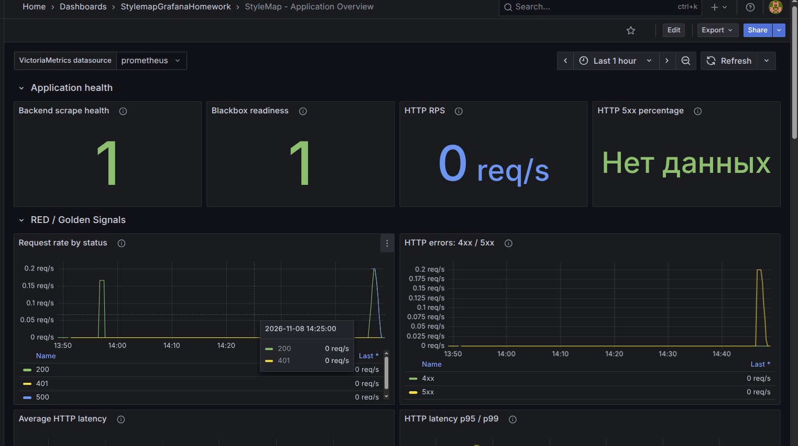
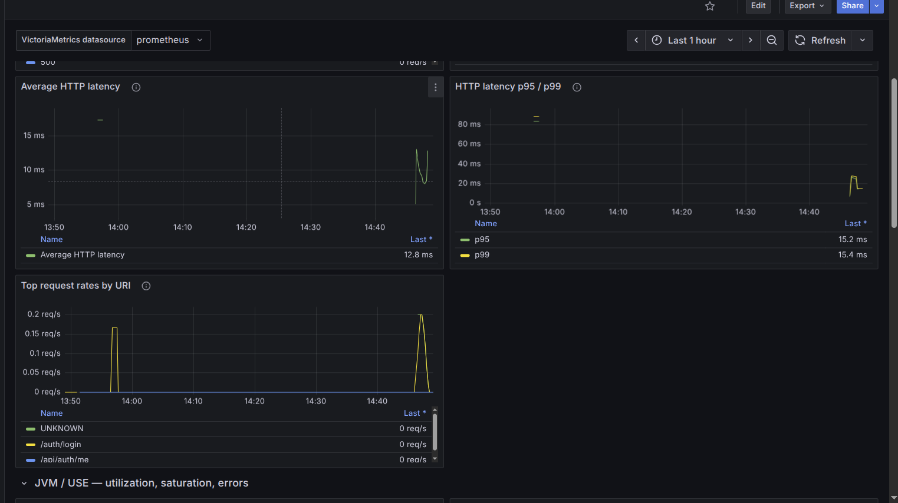
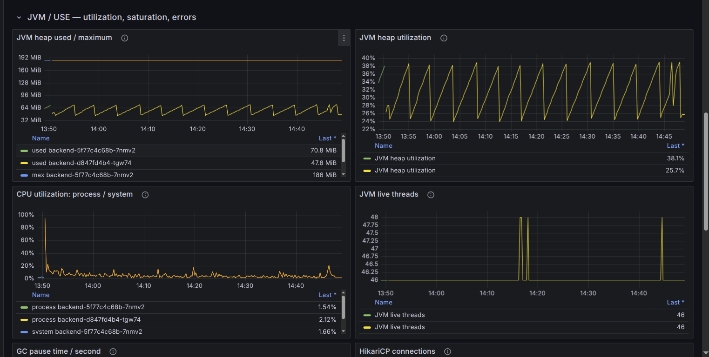
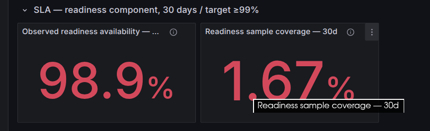
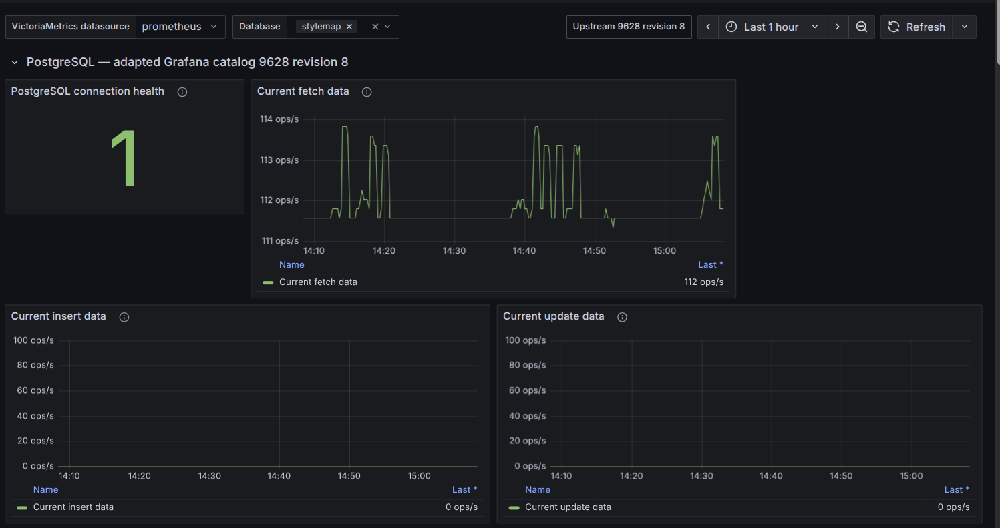
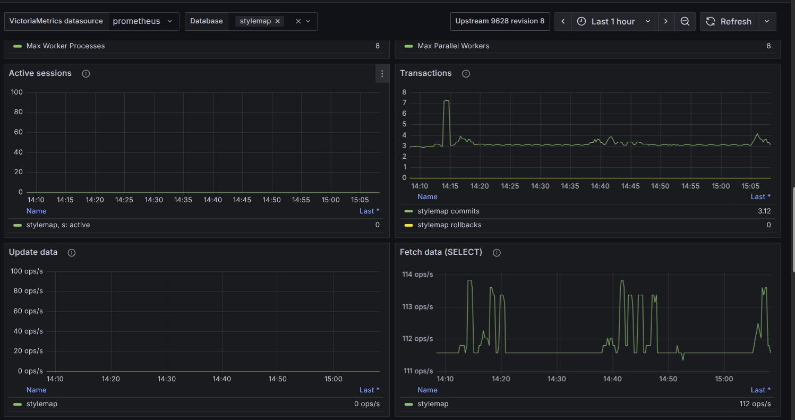
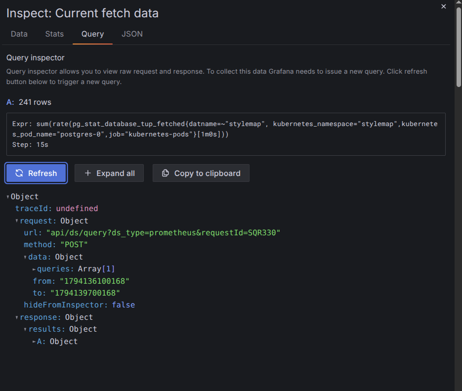

# StyleMap: Grafana Dashboard

## Статус и источник данных

Dashboards сохранены в Grafana и экспортированы. Основные файлы сдачи — **`StyleMapApplicationDashboard.json`** и **`PostgresExporterDashboard.json`**. Их JSON проверены и сопоставлены с исходными переносимыми конфигурациями. Все 56 targets, units, descriptions и layout совпадают; дополнительные defaults Grafana сохранены. SHA256 обоих exports совпадают с предыдущим аудитом, файлы не изменялись. **Все шесть категорий evidence представлены семью реальными PNG; изображения проверены декодированием и просмотрены. Запись существует: [screencast/grafana.mp4](screencast/grafana.mp4). Новые запросы к Grafana/VM и измерения SLA в этой финализации не выполнялись.**

В обоих exports panels/targets ссылаются на datasource variable `DS_PROMETHEUS` (type=`datasource`, query=`prometheus`). Сохранённый выбор: UI-имя `prometheus`, UID `ag3o6jjh0lb7kb`; это не пароль. Снимки приложения и PostgreSQL подтверждают выбор `prometheus` в поле VictoriaMetrics datasource. PostgreSQL Query Inspector показывает запрос с `ds_type=prometheus`, раскрытым `datname=~"stylemap"` и результатом **241 rows**. Это подтверждает выполнение показанного запроса выбранным source в момент снимка. UID — локальная настройка; URL backend отсутствует в JSON и на этих screenshots, поэтому его отдельная визуальная проверка не заявляется. По ранее установленной инфраструктуре source подключён к Prometheus API VictoriaMetrics. Встроенная annotation `-- Grafana --` использует внутренний datasource Grafana.

Архитектура по конфигурации репозитория и ранее установленному контексту: Grafana 12.2.0 — namespace `stylemap`, Service `grafana:3000`; VictoriaMetrics — namespace `monitoring`, Service `vm-single-victoria-metrics-single-server:8428`. VictoriaMetrics собирает `/actuator/prometheus` backend на management port 8081; приложение принимает HTTP на 8080. PostgreSQL Exporter v0.20.1 — sidecar `postgres-0`, endpoint `:9187/metrics`. Blackbox Exporter в `stylemap` выполняет HTTP probe внутреннего backend readiness; VictoriaMetrics собирает его `/probe` через job `stylemap-readiness` каждые 15s. Grafana запрашивает metrics через Prometheus API VictoriaMetrics, не напрямую у exporters. Логирование/alerting существуют отдельно и не являются источником панелей этих dashboards. Runtime-состояние архитектуры в этой финализации заново не измерялось; application/Kubernetes/deployed Grafana не изменялись.

## Application Overview

Высокоуровневые Stat-панели показывают backend scrape health, Blackbox readiness, HTTP RPS и процент 5xx. `up` означает успешность scrape обнаруженных targets, а `probe_success` — успешность HTTP readiness с проверкой тела. Исчезнувший target не считается обнаруженным; ни одна из этих панелей сама по себе не доказывает доступность frontend для пользователя.

RED/Golden Signals: скорость запросов по HTTP status и URI, отдельные скорости 4xx/5xx, средняя длительность и p95/p99. Источники — `http_server_requests_seconds_count`, `_sum`, `_bucket`, scope `app="backend",kubernetes_namespace="stylemap",job="kubernetes-pods"`. `rate` применяется до суммирования, что корректно обрабатывает перезапуски counters. Средняя задержка взвешена числом запросов; квантили рассчитаны через `histogram_quantile` по `sum by (le)` buckets всех pod/URI/status. Это общие HTTP-квантили, не среднее из квантилей и не business publication latency SLI.

Runtime/USE: heap used/max и utilization по pod, process/system CPU, живые threads, GC pause seconds per second, HikariCP active/idle/pending/max, utilization и timeout rate. Heap/CPU/connections характеризуют utilization; pending connections — saturation; Hikari timeouts и HTTP errors — ошибки. JVM live threads и GC дают runtime-контекст. Это не полная USE-модель диска/сети или node monitoring: соответствующих источников в этот dashboard не добавляли. CPU gauges уже нормированы в 0..1; на них не применяется rate. GC измеряется в секундах пауз за секунду. Пороговые значения heap/pool 75/90% и HTTP errors 1/5% — только визуальные ориентиры, не новые SLO.

В application export 19 содержательных панелей и 4 строки разделов, 26 query targets. Точные выражения каждой панели находятся в [QUERIES.md](QUERIES.md), применимом также к реальным exports благодаря совпадению targets. Описания встроены в JSON. Legends по status, URI, pod и pool заданы там, где это предусмотрено конкретным target; часть charts использует фиксированную легенду. Единицы — requests/s, seconds, bytes, percent и connections.

## Нулевой трафик и неизвестные данные

Не используется `or vector(1)` и безусловная подмена отсутствия метрик нулём. Если общий HTTP counter наблюдается, но 5xx counter ещё не создан, fallback `0 * total_rate` даёт нулевой числитель. При нулевом total rate процент ошибок и mean latency не определены — показывается «Нет данных». Для полностью отсутствующего HTTP counter значение также не создаётся. Histogram без наблюдений даёт пустой результат/NaN. Это не подтверждает успех. Пропуски части targets требуют отдельной проверки scrape health и истории, даже если другие targets продолжают отдавать series.

## Readiness-компонент SLA

Исходник в полном репозитории: `submission-slo/Отчёт_SLI_SLO_SLA.md`, раздел «Реальный иллюстративный отчётный период». Найдены **30 суток**, **15 секунд** между проверками, readiness target **≥99%**. Новое значение цели не выдумывалось; необходимые определения перенесены сюда, чтобы минимальная сдача не зависела от файла вне архива. Основная Stat-панель:

```promql
100 * avg_over_time(probe_success{job="stylemap-readiness",instance="http://backend-management.stylemap.svc.cluster.local:8081/actuator/health/readiness"}[30d])
```

Отдельная панель coverage: `100 * count_over_time(probe_success{...}[30d]) / 172800`. Знаменатель — число плановых проб за 30 суток при 15s. Период фиксирован и не меняется от time picker. При неполной истории результат avg — среднее по доступным отсчётам, **не подтверждение SLA**. При coverage<100%, пропусках или дубликатах нужна проверка полноты; автоматическое юридическое заключение не вычисляется. Это учебная оценка sampled probe availability, не контрактная гарантия.

Прежний общий SLA — логическое И readiness ≥99%, PostgreSQL ≥99% и publication latency compliance ≥95%. Новая панель показывает только readiness-компонент и не заменяет старый общий SLA. Существующие SLI/SLO/SLA calculations, alerting, Blackbox и PostgreSQL configuration не изменялись. Сокращённый demo-период 2 минуты из старой работы здесь не используется для подмены 30-дневного отчёта.

**Исторический контекст и фактический screenshot:** ранее пользователь сообщал **98.9% availability / 1.57% coverage**. Представленный теперь `04-readiness-sla.png` показывает **98.9% / 1.67%**. Это разные снимки состояния; 1.57% не подменяется новым числом и не объявляется повторно измеренным. Время самого SLA screenshot внутри crop не показано. Значения 98.9%/1.67% прочитаны с изображения, а не получены новым запросом.

Availability — доля успешных среди имеющихся samples `probe_success` в `[30d]`; 98.9% ниже target 99% на 0.1 процентного пункта, но не означает 98.9% подтверждённой доступности за все 30 суток. Coverage — число собранных samples относительно 172800 плановых проб, **не uptime** и не доля успешных probes. При 1.67% это около 2886 samples, примерно 12 часов эквивалентного покрытия при 15s; округление и возможные разрывы не позволяют утверждать точное число или непрерывность часов. Исторические 1.57% соответствовали примерно 2713 samples / 11.3 часа. При обоих вариантах покрытия 30-дневный SLA **не подтверждён**. Неизвестные интервалы нельзя считать ни успехом, ни доказанным простоем. JSON dashboards не хранит результатов вычислений; `validation-results.json` содержит число series, а не эти проценты.

## PostgreSQL dashboard

Выбран [PostgreSQL Database 9628 revision 8](https://grafana.com/grafana/dashboards/9628-postgresql-database/) из публичного каталога Grafana. Сохранён исходный download и подготовлен `postgresql-exporter-dashboard.json` с явной пометкой adapted. Простого выбора datasource для исходника недостаточно: он предполагает Helm release labels и старые метрики. Обоснование всех адаптаций — README и `postgresql-compatibility.json`.

Фактический PostgreSQL export `PostgresExporterDashboard.json` содержит 27 содержательных панелей, 1 строку и 30 query targets. Ранее проверены метрики pg_up, settings, stat_database, activity, locks и поддерживаемые bgwriter counters; export сохраняет эти запросы. Database variable позволяет показать All или stylemap и получает datname через `pg_stat_database_numbackends`; она multi-select с All=`.*`. Нет Helm-фильтра `release`, scope ограничен `postgres-0` в `stylemap`. Queries tuples/transactions/conflicts/temp/buffers используют rate, настройки и session counts — gauges. Cache Hit Rate — отношение накопленных block counters с момента сброса статистики, не interval hit rate; при нулевом знаменателе возможен NaN. Это ограничение upstream запроса сохранено, а не скрыто. Ресурсы самого exporter не выдаются за CPU/memory PostgreSQL. Никакие collectors/extensions не включались. Повторный импорт в текущий Grafana не требуется.

## Выполненная проверка и ограничения

**Историческая runtime-проверка:** `validation-results.json` датирован 2026-11-08 10:58:57 UTC. В нём 56 успешных API queries, для каждого были непустые series без nonfinite значений. Macros были заменены на 5m и database regex `.*`; использовался обычный GET-трафик, без отказа backend/БД. Это результаты предыдущего этапа, не новые замеры финализации. `grafana_import_verified=false` в том файле описывает состояние до предоставления exports и не отменяет последующее сообщение пользователя об экспорте. Исходный файл проверки сохранён.

**Текущая offline-проверка:** strict JSON parsing (включая duplicate keys), уникальные panel/ref IDs, metric families по сохранённому inventory, все panel/target datasource references, variable dependencies и сравнение queries/layout/units/descriptions с generated JSON. Исходные переносимые файлы имеют null id/uid; реальные exports имеют Grafana IDs 2/3 и собственные UIDs, schemaVersion 42, pluginVersion 12.2.0. Результат и SHA256 exports сохранены отдельно в `export-review.json`; подробности и назначение всех файлов — [EXPORT_REVIEW.md](EXPORT_REVIEW.md).

При финализации evidence повторно выполнены `inspect_exports.py`, `validate.py`, `inspect_evidence.py`; все проверки пройдены. Проверены относительные Markdown image/video links, исходные SHA256 двух exports и media hashes, `git diff --check` и `git diff --cached --check` — без ошибок. Это offline-результаты, не новые измерения качества сервиса.

**Проверка evidence:** семь PNG корректны по формату, полностью декодированы и просмотрены. Скриншоты подтверждают rendering показанных панелей, выбор datasource `prometheus` и Database=`stylemap`. Query Inspector показывает `sum(rate(pg_stat_database_tup_fetched{datname=~"stylemap",kubernetes_namespace="stylemap",kubernetes_pod_name="postgres-0",job="kubernetes-pods"}[1m0s]))`, Step 15s, 241 rows и объект response/results без видимой ошибки. Прямой URL VictoriaMetrics и режим Database=All на этих кадрах не показаны, поэтому отдельная проверка этих двух деталей не заявляется.

MP4 проверен по ISO-BMFF atom structure и metadata: **250150863 bytes**, **324.533 s (5:24.533)**, video `avc1` (H.264), **1280×718, 30 fps, 9736 samples**; есть audio track `mp4a` с ненулевыми samples. Проверены границы контейнерных блоков, наличие `ftyp`, `moov`, `mdat` и ненулевая длительность. В среде нет ffprobe/ffmpeg или видеодекодера; полное воспроизведение, разборчивость звука и весь сюжет записи не проверены. Перед отправкой нужен обычный локальный просмотр начала/середины/конца и звука. Metadata/hashes сохранены в `evidence-review.json`; проверка повторяется `python3 submission-grafana/inspect_evidence.py` (Pillow требуется для PNG).

Скриншоты — свидетельство состояния в момент capture, не новые текущие замеры и не доказательство SLA за 30 суток. Область GC/HikariCP на JVM screenshot обрезана: видны заголовки нижних панелей, но не их значения. Для полного статического evidence всех USE-панелей полезен дополнительный кадр; наличие запросов подтверждается JSON. Это ограничение не скрывается за заявлением о просмотре каждой панели.

## Реальные скриншоты

### Application health



Видны `prometheus`, Last 1 hour, scrape/readiness=1, RPS=0 и 5xx percentage=«Нет данных». Это не 0% ошибок: отношение не определено при нулевом трафике. Зелёный текст «Нет данных» не является подтверждением успеха. На графиках status/errors видна предыдущая активность.

### RED / Golden Signals



Показаны mean и histogram quantiles, URI `/auth/login`, `/api/auth/me`, UNKNOWN. Legend Last* содержит mean 12.8 ms, p95 15.2 ms, p99 15.4 ms — последние доступные точки (`lastNotNull`), а не гарантированная задержка запроса сейчас. Status и 4xx/5xx-графики дополняет предыдущий кадр.

### JVM / USE



Видны heap used/max, utilization, CPU и threads. Несколько pod series в часовом диапазоне не доказывают одновременную работу нескольких replicas. GC/HikariCP значения ниже края crop не видны.

### Readiness SLA



Readiness-компонент: 98.9% по имеющимся samples при coverage 1.67%. Цель ≥99% и окно 30 days видны в заголовке. Полный SLA не подтверждён.

### PostgreSQL Exporter dashboard





Выбран datasource `prometheus` и Database=`stylemap`. Показаны `pg_up=1`, fetch около 112 ops/s, insert/update=0; во втором кадре sessions=0, commits около 3.12/s и rollbacks=0. Это наблюдения с изображений, не новая проверка подключения к БД. Режим All настроен в JSON, но его переключение screenshot не доказывает.

### PostgreSQL Query Inspector



Развёрнутый запрос показывает `datname=~"stylemap"`, rate interval 1m0s, Step 15s и 241 rows. Объекты request/response относятся к Grafana datasource API, а не к прямому SQL-запросу Grafana в PostgreSQL.

## Скринкаст

[Смотреть/скачать screencast/grafana.mp4](screencast/grafana.mp4) — запись существует, длительность по metadata 5:24.533. [План и статус проверки записи](screencast-plan.md). Перед отправкой остаётся локальная проверка воспроизведения/звука. Состав будущего архива и исключаемые промежуточные файлы — [FINAL_CONTENTS.md](FINAL_CONTENTS.md). Архив ещё не создавался.
