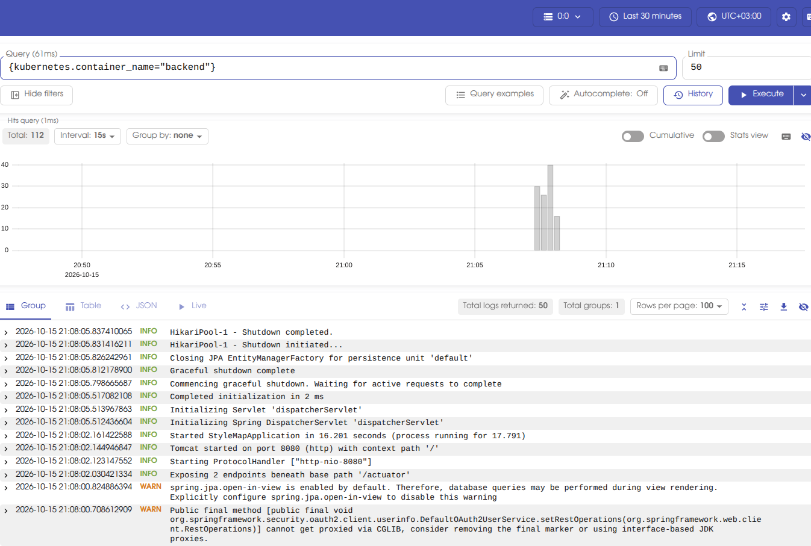
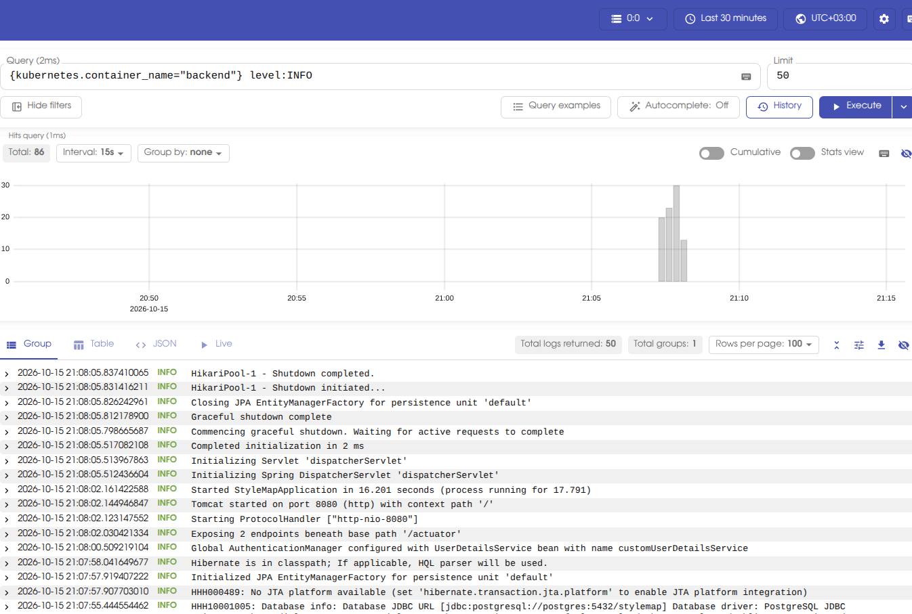
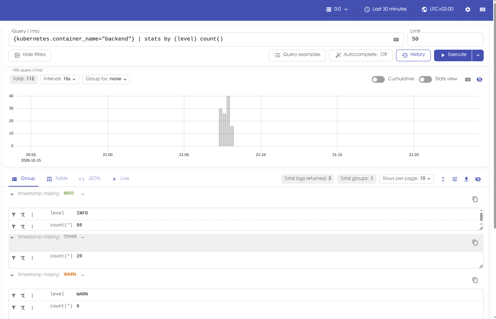
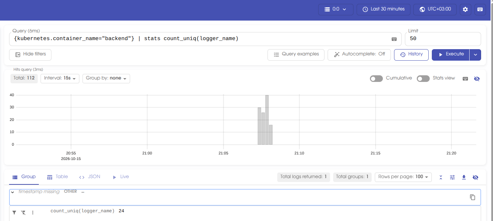
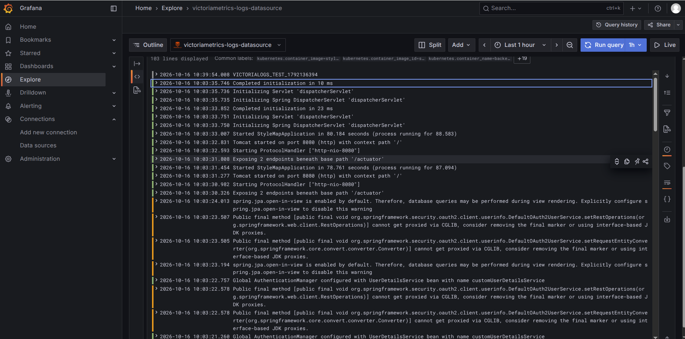

# Отчёт — сбор и анализ логов приложения в Victoria Logs

## 1. Цель работы

В существующий Minikube-кластер с приложением StyleMap была добавлена Victoria Logs в single-node конфигурации. Для backend-приложения настроено структурированное логирование в JSON и доставка контейнерных логов в Victoria Logs с помощью Vector.

## 2. Развёртывание Victoria Logs

Victoria Logs развёрнута в namespace `stylemap` как отдельный `Deployment`. Для хранения данных используется `PersistentVolumeClaim`, а доступ внутри кластера предоставляется через `ClusterIP Service` на порту `9428`.

Для доступа к веб-интерфейсу использовался port-forward:

```bash
kubectl port-forward -n stylemap service/victoria-logs 9428:9428
```

После этого vmui доступен по адресу `/select/vmui/`.

## 3. JSON-логирование приложения

Backend StyleMap настроен на вывод структурированных JSON-логов в `stdout`. В записях присутствуют обязательные поля:

- `timestamp`;
- `level`;
- `message`;
- `service.name`.

Значение `service.name` для backend — `stylemap-backend`.

Дополнительно в логах присутствуют поля `logger_name`, `thread_name`, `level_value` и другие служебные поля.

## 4. Доставка логов

Для доставки логов выбран **Vector в виде DaemonSet**.

Такой способ выбран потому, что приложение продолжает писать логи стандартным способом в `stdout` и не зависит напрямую от Victoria Logs. Kubernetes сохраняет контейнерные логи на узле, а Vector читает их через источник `kubernetes_logs`, добавляет Kubernetes metadata и отправляет записи в Victoria Logs.

Схема доставки:

```text
Spring Boot backend
        |
        | JSON stdout
        v
Kubernetes container logs
        |
        v
Vector DaemonSet
        |
        | HTTP /insert/jsonline
        v
Victoria Logs
```

Перед отправкой Vector разбирает JSON из поля `message`, поэтому `level`, `service.name`, `logger_name` и другие поля становятся отдельными полями записи в Victoria Logs. В качестве stream-полей используются namespace, имя pod и имя контейнера.

## 5. LogsQL-запросы

Для всех запросов использовался временной диапазон **Last 30 minutes**.

### 5.1. Сырые записи backend

```logsql
{kubernetes.container_name="backend"}
```

Запрос выводит все записи контейнеров backend за выбранный временной диапазон. Фильтрация выполняется по Kubernetes metadata, добавленным Vector.



### 5.2. Фильтр по полю `level`

```logsql
{kubernetes.container_name="backend"} level:INFO
```

Запрос оставляет только сообщения backend с уровнем `INFO`. На скриншоте видно, что после фильтрации количество найденных записей уменьшается по сравнению с запросом без фильтра.



### 5.3. `stats` с группировкой по уровню

```logsql
{kubernetes.container_name="backend"} | stats by (level) count()
```

Запрос группирует записи backend по полю `level` и подсчитывает количество сообщений в каждой группе. В полученном результате: `INFO` — 86 записей, `WARN` — 6 записей, `OTHER` — 20 записей.

Категория `OTHER` соответствует записям, для которых поле `level` отсутствует.



### 5.4. Количество уникальных logger'ов

```logsql
{kubernetes.container_name="backend"} | stats count_uniq(logger_name)
```

Агрегирующий запрос подсчитывает количество уникальных значений `logger_name`, то есть число различных Java logger'ов, сформировавших сообщения backend за выбранный период. В данном запуске получено **24 уникальных logger'а**.



## 6. Бонус: Grafana

В качестве бонусной части задания Victoria Logs была подключена к Grafana с помощью официального плагина `victoriametrics-logs-datasource`.

В Grafana настроен источник данных VictoriaLogs, который обращается к Service Victoria Logs внутри Kubernetes-кластера:

```text
http://victoria-logs:9428
```

Успешная работа источника данных подтверждается отображением логов Spring Boot backend в Grafana Explore. Для просмотра записей контейнеров backend использовался фильтр:

```logsql
kubernetes.container_name:="backend"
```

На скриншоте видны логи backend, включая тестовую запись `VICTORIALOGS_TEST_*`. Для дополнительной проверки доставки эта строка была записана в `stdout` backend, собрана Vector и передана в Victoria Logs, после чего появилась в Grafana Explore. Таким образом подтверждена работа всей цепочки доставки логов от контейнера приложения до Grafana.



## 7. Результат

В результате работы:

- Victoria Logs single-node развёрнута в том же Minikube-кластере, что и StyleMap;
- данные Victoria Logs сохраняются в PVC;
- backend приложения пишет структурированные JSON-логи в `stdout`;
- Vector работает как DaemonSet и собирает Kubernetes container logs;
- JSON-поля backend сохраняются как отдельные поля в Victoria Logs;
- vmui доступен через `kubectl port-forward`;
- выполнены четыре требуемых LogsQL-запроса: просмотр сырых записей, фильтрация по полю, `stats` с группировкой и агрегирующий `count_uniq`;
- в качестве бонуса Victoria Logs подключена к Grafana через официальный datasource-плагин;
- получение логов backend через Grafana Explore успешно проверено.
